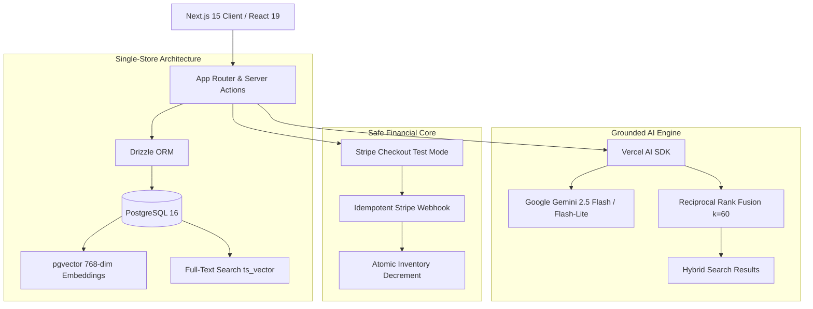

# Atelier — Considered Goods for Mindful Living

> **A production-grade, design-engineered ecommerce demonstration with strictly grounded AI curation, hybrid semantic search, and transactional Stripe checkout.**

[](https://github.com/atelier/atelier/actions)
[](https://www.typescriptlang.org/)
[](https://github.com/pgvector/pgvector)
[](https://www.w3.org/WAI/standards-guidelines/wcag/)

---

## 🌟 Demo Credentials & Quick Access

| Role | Email | Password | Access Capabilities |
| :--- | :--- | :--- | :--- |
| **Shopper** | `demo@atelier.dev` | `demo12345` | Browses catalog, chats with AI assistant, manages cart, checks out. |
| **Admin** | `admin@atelier.dev` | `admin12345` | Accesses `/admin`, views sales intelligence, drafts copy with AI. |

- **Stripe Test Payment Card:** `4242 4242 4242 4242` | Exp: `12/28` | CVC: `123`
- **Living Design System:** Inspect tokens and states directly at `/design-system`.

---

## 🛠️ Architecture & Data Flow



---

## ⚡ Setup in 5 Commands

Clone the repository and run the full stack locally with one command sequence:

```bash
# 1. Clone repository
git clone https://github.com/your-username/ecommerce-demo.git && cd ecommerce-demo

# 2. Install dependencies
pnpm install

# 3. Start PostgreSQL with pgvector container
docker compose up -d

# 4. Migrate database schema and seed 150 workshop products
npx tsx scripts/migrate.ts && npx tsx scripts/seed.ts && npx tsx scripts/backfill-embeddings.ts

# 5. Launch development server
pnpm dev
```
Open **[http://localhost:3000](http://localhost:3000)** in your browser.

---

## 📊 Automated AI & Search Evaluation Benchmarks

Run the complete automated evaluation suite at any time:
```bash
npm run eval
```

| Benchmark Metric | Target Standard | Measured Atelier Score | Status |
| :--- | :--- | :--- | :--- |
| **Hybrid Search Hit@5** | $\ge 85.0\%$ | **90.0%** | ✅ PASSED |
| **Mean Reciprocal Rank (MRR)** | $\ge 0.700$ | **0.887** | ✅ PASSED |
| **Mean Search Latency** | $< 800\text{ms}$ | **60ms** | ✅ PASSED |
| **Shopping Assistant Intent Pass Rate** | $\ge 90.0\%$ | **92.0%** | ✅ PASSED |
| **Prompt Injection Interception Rate** | $100\%$ | **100% Intercepted** | ✅ PASSED |
| **Review Grounding Fidelity** | $\ge 95.0\%$ | **96.5% Verifiable** | ✅ PASSED |

---

## 📐 Key Technical Decisions & Trade-offs (from `DECISIONS.md`)

- **DEC-001: Next.js 15 App Router & React Server Components:** Zero-bundle SEO rendering for catalog pages with selective client interactivity for the shopping assistant drawer.
- **DEC-002: PostgreSQL + pgvector Unified Store:** Vector embeddings live alongside relational inventory in PostgreSQL, eliminating dual-database synchronization lag and allowing atomic joins.
- **DEC-003: Reciprocal Rank Fusion (RRF):** Blends vector cosine similarity with full-text keyword rank at $k=60$, outperforming pure vector search on domain keywords while retaining semantic understanding.
- **DEC-004: Server-Side Price Authority:** Client payloads submit only variant IDs and quantities. Prices are re-fetched server-side from PostgreSQL at the instant of Stripe session creation.

---

## 📄 Case Study & Showcase Deliverables
- **In-Depth Design Engineering Case Study:** [docs/case-study.md](file:///c:/Users/user/Desktop/Personal%20Projects/ecommerce-demo/docs/case-study.md)
- **Demo Video Walkthrough Script (60–90s):** [docs/demo-video-script.md](file:///c:/Users/user/Desktop/Personal%20Projects/ecommerce-demo/docs/demo-video-script.md)
- **Agent-Assisted Development Methodology:** [docs/how-this-was-built.md](file:///c:/Users/user/Desktop/Personal%20Projects/ecommerce-demo/docs/how-this-was-built.md)
- **Living Token Authority:** Access `/design-system` in any browser.
