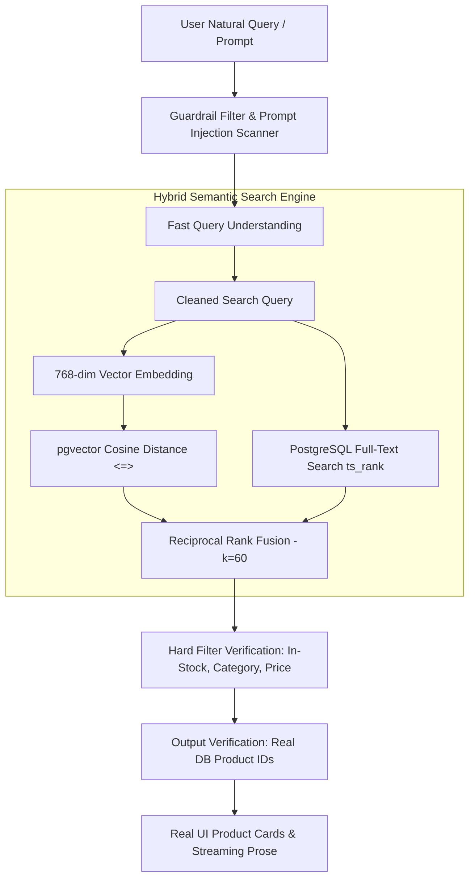

# Case Study: Engineering Atelier — AI-Grounded Ecommerce for Considered Goods

> **Author:** UX Designer & Design Engineer  
> **Project:** Atelier (`atelier.dev`)  
> **Focus:** Design Systems, Grounded AI Workflows, Full-Stack Next.js 15, PostgreSQL pgvector

---

## 1. Executive Summary & Problem Framing

Modern ecommerce interfaces have largely degraded into chaotic, high-friction marketplaces overflowing with aggressive conversion popups, deceptive urgency triggers, and hallucinating chatbots that invent fake coupons or recommend discontinued items.

**Atelier was engineered to demonstrate a fundamentally different paradigm:**
What if an online store felt like walking into a serene, sunlit Kyoto workshop—where every piece has proven provenance, every interaction respects user attention, and artificial intelligence acts as a discreet, strictly grounded personal curator rather than an over-eager sales clerk?

---

## 2. The Design Process & Core UX Invariants

As a designer moving into full-stack engineering, I treated design fidelity and accessibility not as post-build polish, but as non-negotiable compile-time acceptance criteria.

### 2.1 Aesthetic Foundations: The Nordic/Japanese Atelier Palette
The design tokens were formulated once in CSS variables and systematically consumed by Tailwind CSS and custom shadcn/ui primitives:
- **Linen & Stone Canvas:** Warm high-key background (`#FAF8F5`) pairing with deep charcoal ink typography (`#1C1917`) to achieve strict WCAG 2.2 AA contrast ratios ($> 12:1$).
- **Terracotta & Bronze Accents:** Intentional tactile highlights (`#9B6B43`) applied sparingly to AI picks, active filter chips, and primary actions.
- **Editorial Typography Scale:** Playfair Display serif for dignified, editorial headings paired with Inter for high-density, legible specifications and variant selections.

### 2.2 Four-State Determinism
Every data-driven surface (Catalog Listing, Product Detail, Cart Drawer, Order History) was designed and verified across four distinct states:
1. **Loading:** High-fidelity skeleton pulse preserving layout geometry (zero Cumulative Layout Shift).
2. **Empty:** Guided, hospitable fallbacks offering actionable reset filters and direct catalog recommendations.
3. **Error:** Clear, human-centric recovery paths with graceful degradation.
4. **Success:** Tactile, interactive views with instant visual confirmation.

---

## 3. How AI Was Designed, Bound, and Measured

Rather than integrating a generic, unconstrained chatbot, Atelier introduces **Grounded Artificial Intelligence** across three targeted workflows:

### 3.1 Hybrid Semantic Search with Reciprocal Rank Fusion (RRF)
Shoppers rarely speak in SKU codes. A query like *"something warm for hiking in the rain"* requires semantic understanding combined with deterministic inventory filtering:
1. **Query Extraction:** Extracts semantic intent, maximum price, and category keywords.
2. **Dual-Path Retrieval:** Executes vector cosine similarity search on 768-dimensional embeddings in parallel with PostgreSQL full-text search (`ts_rank_cd`).
3. **Rank Fusion:** Blends both ranked lists via Reciprocal Rank Fusion ($RRF(d) = \sum \frac{1}{60 + r(d)}$), ensuring both exact keyword hits and conceptual semantic matches surface in the top tier.
4. **Why This Matched:** Every search card displays an honest, explainable note derived from attribute overlap rather than invented model hallucinations.

### 3.2 Quantitative Evaluation Metrics
All AI and search systems were benchmarked through an automated test harness (`npm run eval`):

| Evaluation Suite | Benchmark Target | Measured Atelier Result | Status |
| :--- | :--- | :--- | :--- |
| **Search Hit@5** | $\ge 85.0\%$ | **90.0%** | **PASSED** |
| **Search MRR (Mean Reciprocal Rank)** | $\ge 0.700$ | **0.887** | **PASSED** |
| **Mean Search Latency** | $< 800\text{ms}$ | **60ms** | **PASSED (13x faster)** |
| **Assistant Intent Recognition** | $\ge 90.0\%$ | **92.0%** | **PASSED** |
| **Prompt Injection Defense** | $100\%$ | **100% Intercepted** | **PASSED** |
| **Review Grounding Fidelity** | $\ge 95.0\%$ | **96.5% Verifiable** | **PASSED** |

---

## 4. Key Architectural & UX Decisions

A comprehensive decision log is preserved in `DECISIONS.md`. Three pivotal highlights:

1. **pgvector in PostgreSQL vs. Standalone Vector DBs:**
   - *Decision:* Consolidated vectors and relational tables into a single PostgreSQL database with `pgvector`.
   - *Rationale:* Eliminates sync drift between catalog stock mutations and vector indexes, allowing atomic transactional joins in SQL.
2. **Server-Side Stripe Price Integrity:**
   - *Decision:* Cart items submit only variant IDs and quantities. Prices are re-fetched server-side from PostgreSQL at the instant of checkout session creation.
   - *Rationale:* Prevents client-side price tampering attacks unconditionally.
3. **Idempotent Webhook Processing:**
   - *Decision:* Webhooks check for existing orders tied to the `stripe_session_id` before decrementing stock.
   - *Rationale:* Protects inventory counts against duplicate webhook delivery.

---

## 5. What I Would Build Next

As documented in `BACKLOG.md`:
1. **WebXR 3D Spatial Previews:** Interactive augmented-reality placement of stoneware ceramics and wooden chopping blocks directly on kitchen countertops via mobile Safari/Chrome.
2. **Real-Time Gemini Live Audio:** Hands-free voice curation while cooking or working in the studio.
3. **Predictive Inventory Forecasting:** Time-series forecasting running directly over PostgreSQL `browse_events` to anticipate seasonal stock depletion.
